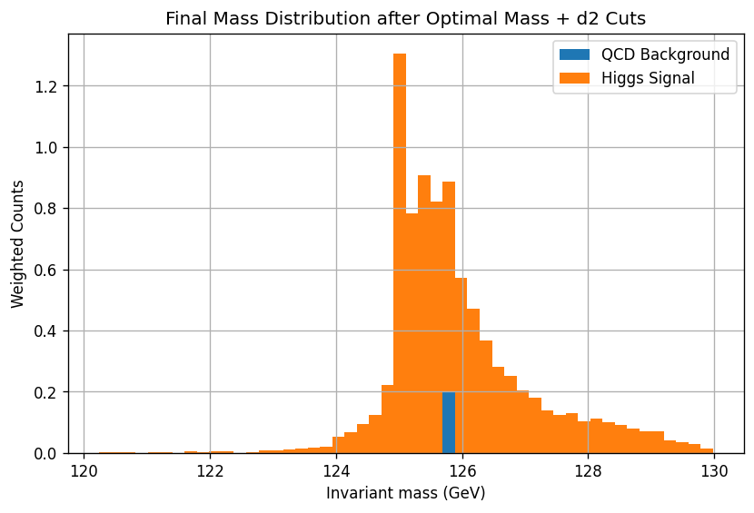
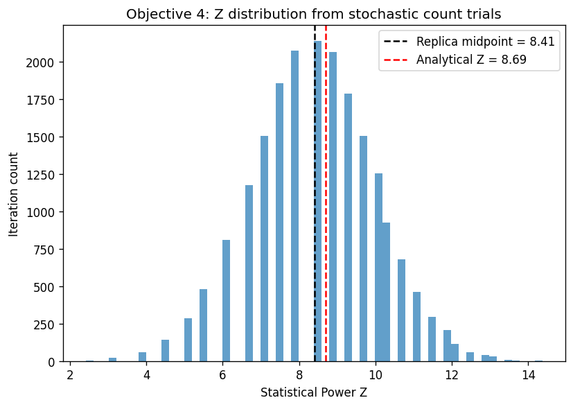
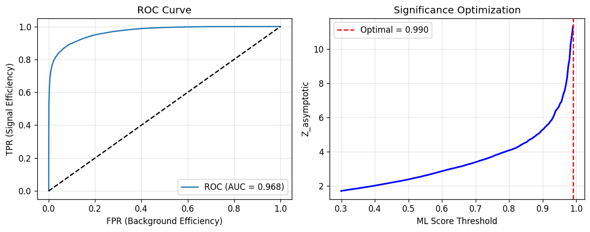

# LHC Higgs Boson Search and Statistical Analysis

Separating simulated Higgs jets from QCD background using jet substructure, then testing whether the result reaches discovery-level significance. Course project for Physics 434 (Data Analysis), Autumn 2025. Python, NumPy, pandas, SciPy, scikit-learn, Matplotlib.

## What this does

1. **Cut-based baseline.** Higgs signal vs QCD background (100,000 simulated jets each, 200,000 total) in the 250 to 500 GeV pT sample. Events are reweighted to expected yields (100 Higgs, 20,000 QCD). A mass window of 120 to 130 GeV is applied, then jet substructure cuts on d2 and t21 are scanned for the best significance.
2. **Asymptotic significance.** Uses the median-significance formula Z_A from Cowan et al. (arXiv:1007.1727, Eq. 97) in place of the simple s/sqrt(b), which overstates significance when the background is tiny.
3. **Poisson toy Monte Carlo.** 20,000 pseudo-experiments with Poisson-fluctuated signal and background counts check the analytic significance against a simulated one.
4. **Machine learning selection.** A Gradient Boosting classifier on 6 features (mass, d2, t21, pt, eta, phi) replaces the rectangular cuts, with the score threshold optimized for Z_A.

## Results (250 to 500 GeV sample)

| Selection | Expected S | Expected B | Z (asymptotic) |
|---|---|---|---|
| Rectangular cuts (mass 120 to 130, d2 <= 0.655, t21 <= 0.414) | 14.04 | 0.40 | 8.69 |
| Gradient Boosting, score >= 0.99 | 42.29 | 5.00 | 11.31 |

- Signal pass-rate for the cuts is 0.140 and the background pass-rate is 2.0e-5.
- Toy Monte Carlo (20,000 pseudo-experiments): median Z = 8.41 against 8.69 analytic, so the formula holds up. Both are above the 5 sigma discovery threshold.
- Classifier AUC is 0.969 on a held-out 30% split. Feature importance: d2 0.42, mass 0.39, t21 0.11, pt 0.06, eta 0.02, phi 0.0002.
- Significance falls below 5 sigma when the total post-selection yield drops to about 4 events at the same signal to background ratio.





## Limitations

- The classifier is trained on a 70% split but scored and thresholded on the full samples, so the 11.31 sigma figure is optimistic. A clean estimate needs the threshold chosen on one split and the yields measured on another.
- The best threshold (0.99) sits at the edge of the scanned range (0.3 to 0.99), so a higher cut might do better.
- The high-pT bonus section in `01_cut_based_analysis.py` uses raw event counts rather than weighted yields, so its significance value is not comparable to the numbers above.
- Single random seed; no uncertainty on the classifier-based number.

## Layout

```
src/01_cut_based_analysis.py          Lab 5: distributions, weighting, mass window, d2 scan, high-pT bonus
src/02_significance_toys_ml.py        Labs 7 and 8: Z_A, 3D cut sweep, Poisson toys, pseudo-data, ML selection
src/03_significance_vs_yield_plot.py  Z_A versus total yield at fixed S/B
figures/                              Selected plots
```

The scripts are notebook exports in cell format (`# %%`), so they run in Spyder, VS Code or as plain scripts.

## Data

The simulated jet samples (`higgs_100000_*.pkl`, `qcd_100000_*.pkl`) and pseudo-experiment files (`data_*Lumi_*.h5`) come from the course and are not included. Place them in the working directory, or adjust the paths at the top of each script.

## Setup

```
pip install -r requirements.txt
```

Course project; code written by Nirmal Kumar Marimuthu.
